# Helpdesk Lab — Active Directory & Windows Server Technical Documentation

**Role Simulated:** Tier 1/2 IT Helpdesk & Junior Systems Administrator

**Domain:** `karem.com` | **Domain Controller:** `ALX-DC-01` | **Client:** `DESKTOP-P80NB90`

**Platform:** VMware Virtual Lab (Windows Server 2022 + Windows 10 Enterprise)

> This document records the build, configuration, security hardening, and verification of an enterprise Active Directory environment, supported by sequential evidence screenshots for each phase. It covers directory architecture, object recovery, Group Policy enforcement, NTFS access control design, network drive mapping, client domain integration, remote administration via RSAT, and least-privilege delegation.

## Table of Contents

1. [Lab Topology Overview](#1-lab-topology-overview)
2. [Implementation & Verification Log (Phases 1–11)](#2-implementation--verification-log-phases-111)
3. [IT Support & Domain Controller Command Reference](#3-it-support--domain-controller-command-reference)
4. [Troubleshooting Log](#4-troubleshooting-log)
5. [Operational Observations](#5-operational-observations)

## 1. Lab Topology Overview

### 1.1 Architecture Summary

| Component | Value | 
| :--- | :--- | 
| **Forest / Domain** | `karem.com` (Single forest, single domain) | 
| **NetBIOS Domain Name** | `KAREM` | 
| **Domain Controller** | `ALX-DC-01` — Windows Server 2022 Standard Evaluation (Build `10.0.20348.587`) | 
| **Domain Client** | `DESKTOP-P80NB90` — Windows 10 Enterprise (Build `10.0.19045.6466`) | 
| **Hypervisor** | VMware Virtual Platform | 
| **DC Hardware Profile** | 2 GB RAM, 24.39 GB disk, 13th Gen Intel Core i7-13650HX host CPU | 
| **Management Plane** | Server Manager (Remote Management Enabled), ADAC, ADUC, GPMC, Client RSAT | 

### 1.2 Network Adapter Topology

| Adapter / Host | Role | Addressing | DNS | Evidence | 
| :--- | :--- | :--- | :--- | :--- | 
| **Ethernet0** (`00-0C-29-E1-9C-04`) | DC Primary NIC | DHCP (`192.168.169.139/24`), GW `192.168.169.2` | `::1`, `127.0.0.1` (Loopback) | Phase 1, Phase 4 | 
| **Ethernet1 (NAT)** | Client/DC Shared Segment | Reachable DC Address: `192.168.169.137` | Points to `192.168.169.137` | Phase 8 (`ping` source) | 
| **DESKTOP-P80NB90** | Domain Workstation | Client IP (`192.168.169.133`) | `192.168.169.137` | Phase 8 | 

*Note: Multi-adapter routing and the transition from `.139` to `.137` are documented in detail in the [Troubleshooting Log](#4-troubleshooting-log).*

### 1.3 Directory Structure (OU Design)

```
karem.com
├── Builtin
├── Computers
├── Domain Controllers
├── ForeignSecurityPrincipals
├── Managed Service Accounts
├── Users
└── Departments
    ├── IT_Department      → Mohamed E.., Sara Jack (sjack04), GRP_IT_Helpdesk
    ├── HR_Department      → GPO_HR_Security_Restrictions (Linked)
    └── Sales_Department   → Delegated to GRP_IT_Helpdesk
```

### 1.4 Identity & Access Summary

| Object | Type | Location | Purpose | 
| :--- | :--- | :--- | :--- | 
| **Sara Jack** (`sjack04`) | User | `IT_Department` | Helpdesk technician; domain logon verified on client | 
| **GRP_IT_Helpdesk** | Security Group | `IT_Department` | Role group (`KAREM\GRP_IT_Helpdesk`) for NTFS rights & AD delegation | 
| **Mohamed E..** | User | `IT_Department` | IT staff account | 
| **Mark Mandy** (`mmandy`) | User | `Deleted Objects` | Deleted account recovered via AD Recycle Bin | 
| **GPO_HR_Security_Restrictions** | GPO | `HR_Department` | Screen lock timeout and removable storage restrictions | 
| **C:\\Company_Shares\\IT_Files** | NTFS / SMB Share | `ALX-DC-01` | Restricted IT file share, mapped as drive `Z:` | 

## 2. Implementation & Verification Log (Phases 1–11)

### Phase 1 — Domain Controller Baseline (AD DS + DNS)

* **Objective:** Establish `ALX-DC-01` as the Primary Domain Controller for `karem.com` and confirm the server security baseline in Server Manager.
* **Technical Configuration:**
  * **Computer Name / Domain:** `ALX-DC-01` / `karem.com`
  * **OS:** Microsoft Windows Server 2022 Standard Evaluation (Activated)
  * **Security Baseline:** Microsoft Defender Firewall (`Private: On`), Defender Antivirus (`Real-Time Protection: On`), Remote Management (`Enabled`), Remote Desktop (`Disabled`).
  * **Network:** `Ethernet0` (IPv4 assigned by DHCP, IPv6 enabled).
* **Security & Operational Rationale:** Disabling Remote Desktop while keeping Server Manager remote management enabled narrows the interactive attack surface of a Tier 0 asset. Administration occurs through authenticated management protocols rather than interactive RDP sessions, while host firewall and real-time AV provide defense-in-depth.
* **Verification Screenshot:**
  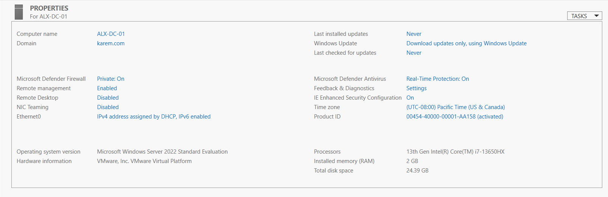

### Phase 2 — Active Directory Recycle Bin & Object Recovery

* **Objective:** Recover an accidentally deleted user account using the AD Recycle Bin in Active Directory Administrative Center (ADAC).
* **Technical Configuration:**
  * **Console Path:** `ADAC → karem (local) → Deleted Objects`
  * **Deleted Object:** `Mark Mandy` (Logon name: `mmandy`, Type: `User`)
  * **Last Known Parent:** `CN=Users,DC=karem,DC=com`
  * **Recovery Method:** `Restore To…` targeting the `Users` container.
* **Security & Operational Rationale:** Enabling the AD Recycle Bin allows non-authoritative recovery of deleted objects with their original Security Identifier (SID), group memberships, and attributes intact—eliminating permission loss and profile mismatches caused by recreating accounts from scratch.
* **Verification Screenshot:**
  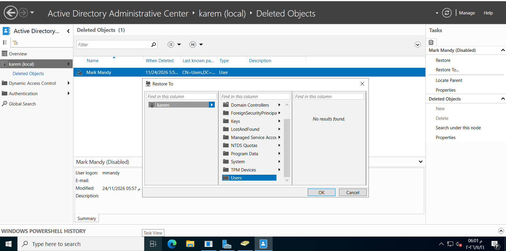

### Phase 3 — OU Hierarchy, Users, and Security Groups

* **Objective:** Build a department-based Organizational Unit (OU) hierarchy and populate it with user accounts and role-based security groups.
* **Technical Configuration:**
  * **Parent OU:** `Departments` under `karem.com`
  * **Child OUs:** `IT_Department`, `HR_Department`, `Sales_Department`
  * **IT_Department Objects:** Users `Mohamed E..` and `Sara Jack` (`sjack04`), Security Group `GRP_IT_Helpdesk`.
* **Security & Operational Rationale:** Grouping departmental OUs under a unified parent allows Group Policies and administrative delegation to be scoped cleanly by business function. Assigning permissions to role groups (`GRP_IT_Helpdesk`) rather than individual accounts aligns with AGDLP best practices.
* **Verification Screenshot:**
  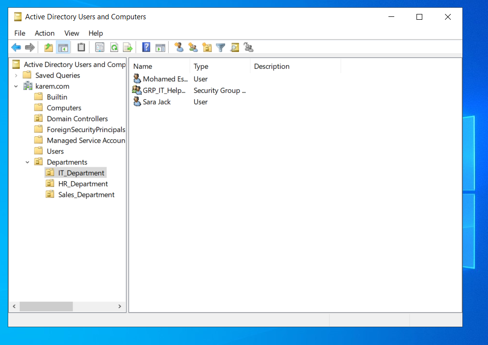

### Phase 4 — Network Diagnostics with `ipconfig /all`

* **Objective:** Validate the Domain Controller's network identity, DNS suffix, and loopback DNS resolution.
* **Technical Configuration:**
  * **Host Name / Primary DNS Suffix:** `ALX-DC-01` / `karem.com`
  * **Adapter:** `Ethernet0` (Intel 82574L Gigabit, MAC `00-0C-29-E1-9C-04`)
  * **IPv4 / Gateway:** `192.168.169.139` (`255.255.255.0`) / `192.168.169.2`
  * **DNS Servers:** `::1`, `127.0.0.1` (Self-referencing local DNS service)
* **Security & Operational Rationale:** Active Directory relies entirely on DNS SRV records for Kerberos, LDAP, and Netlogon service discovery. Running `ipconfig /all` verifies that the DC points to itself for name resolution and confirms active DNS suffix registration.
* **Verification Screenshot:**
  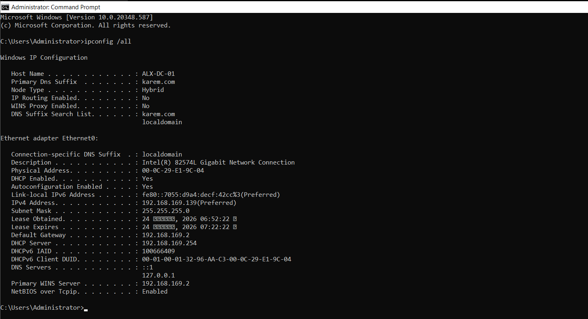

### Phase 5 — Group Policy: `GPO_HR_Security_Restrictions`

* **Objective:** Enforce workstation screen-lock and removable-media restrictions for HR personnel via Group Policy and force an immediate refresh.
* **Technical Configuration:**
  * **GPO Name & Link:** `GPO_HR_Security_Restrictions` linked to `karem.com/Departments/HR_Department`
  * **Personalization Policies:** `Enable screen saver` (`Enabled`), `Password protect the screen saver` (`Enabled`), `Screen saver timeout` (`Enabled: 300 seconds`).
  * **Removable Storage Policies:** `Removable Disks: Deny read access` (`Enabled`), `Removable Disks: Deny write access` (`Enabled`).
  * **Verification Command:** `gpupdate /force` completed successfully for both Computer and User policies.
* **Security & Operational Rationale:** HR handles sensitive employee PII. Enforcing a 5-minute password-protected lock mitigates unauthorized physical access to unattended terminals, while blocking USB storage prevents data exfiltration and malware introduction.
* **Verification Screenshot:**
  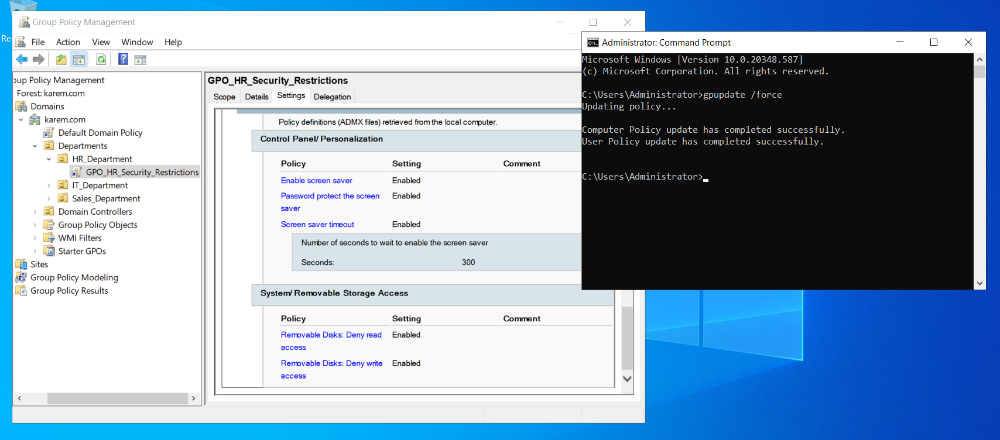

### Phase 6 — NTFS Permissions on `C:\Company_Shares\IT_Files`

* **Objective:** Secure the IT departmental file share with explicit, least-privilege NTFS permissions and disabled inheritance.
* **Technical Configuration:**
  * **Target Path:** `C:\Company_Shares\IT_Files`
  * **Owner:** `Sara Jack` (`sjack04@karem.com`)
  * **Inheritance:** Disabled (explicit Access Control Entries only)

| Type | Principal | Access | Inherited From | Applies To | 
| :--- | :--- | :--- | :--- | :--- | 
| **Allow** | `SYSTEM` | Full control | None | This folder, subfolders and files | 
| **Allow** | `CREATOR OWNER` | Full control | None | Subfolders and files only | 
| **Allow** | `GRP_IT_Helpdesk` (`KAREM\GRP_IT_Helpdesk`) | Modify | None | This folder, subfolders and files | 

* **Security & Operational Rationale:** Breaking inheritance removes implicit access from broad built-in groups (`Users` / `Authenticated Users`). Granting `GRP_IT_Helpdesk` **Modify** instead of **Full control** prevents technicians from altering ACLs or taking ownership while supporting daily file operations (Principle of Least Privilege).
* **Verification Screenshot:**
  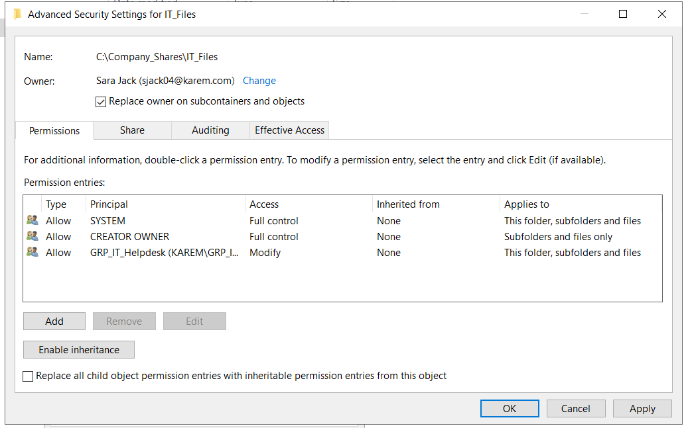

### Phase 7 — Mapped Network Drive (`Z:`)

* **Objective:** Present the restricted IT network share to authorized domain users as a consistent drive letter.
* **Technical Configuration:**
  * **UNC Path:** `\\ALX-DC-01\IT_Files`
  * **Drive Letter:** `Z:` (mounted under *Network locations* in File Explorer)
* **Security & Operational Rationale:** Standardizing shared storage under a persistent drive letter encourages centralized data storage while maintaining server-side access enforcement (the effective permission equals the most restrictive combination of Share and NTFS ACLs).
* **Verification Screenshot:**
  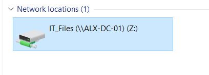

### Phase 8 — Windows 10 Client Domain Join

* **Objective:** Join the Windows 10 Enterprise workstation (`DESKTOP-P80NB90`) to `karem.com` after validating DNS name resolution.
* **Technical Configuration:**
  * **Client Hostname:** `DESKTOP-P80NB90` (Windows 10 Build `10.0.19045.6466`)
  * **Pre-Join Verification:** `ping karem.com` → 4 replies from `192.168.169.137` (`0% loss`)
  * **Domain Join:** `System Properties → Computer Name/Domain Changes → Member of: Domain (karem.com)`
  * **Confirmation:** `"Welcome to the karem.com domain."`
* **Security & Operational Rationale:** Validating DNS resolution prior to domain join isolates network/DNS issues from authentication failures. Joining the client brings the endpoint under centralized Kerberos authentication, Group Policy management, and directory auditing.
* **Verification Screenshot:**
  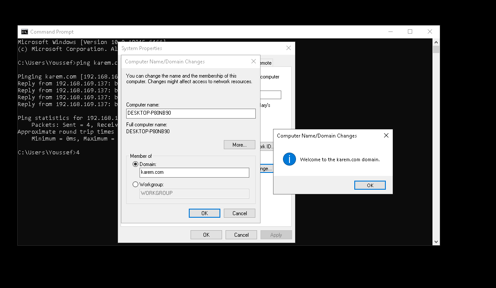

### Phase 9 — Domain User Logon Verification

* **Objective:** Confirm end-to-end Kerberos authentication by logging into the domain-joined client with a domain user account.
* **Technical Configuration:**
  * **User Profile Path:** `C:\Users\sjack04`
  * **Verification Command:** `whoami` → `karem\sjack04`
* **Security & Operational Rationale:** Running `whoami` confirms the active security token was issued by the `KAREM` Domain Controller rather than a local SAM account, verifying healthy domain trust and profile provisioning.
* **Verification Screenshot:**
  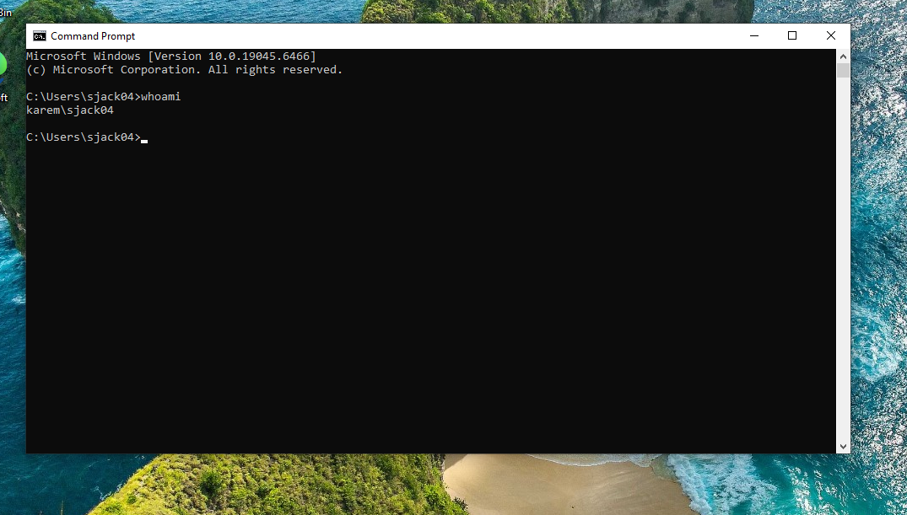

### Phase 10 — Remote Administration with RSAT

* **Objective:** Administer Active Directory objects remotely from the Windows 10 workstation using Remote Server Administration Tools (RSAT).
* **Technical Configuration:**
  * **Tool:** Active Directory Users and Computers (`dsa.msc`) launched from *Windows Administrative Tools* on `DESKTOP-P80NB90`.
  * **Live Directory View:** Connected to `karem.com`, displaying `Departments` (`HR_Department`, `IT_Department`, `Sales_Department`) and `IT_Department` members.
* **Security & Operational Rationale:** Using RSAT from an administrative workstation eliminates routine interactive logons to the Domain Controller console, reducing credential exposure on Tier 0 infrastructure.
* **Verification Screenshot:**
  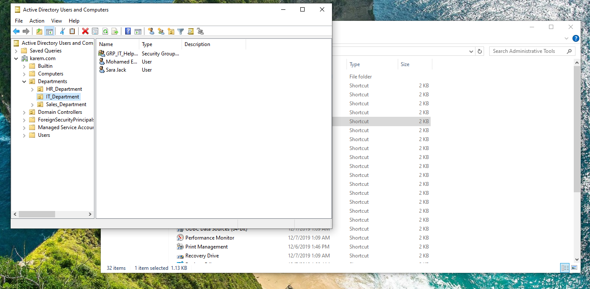

### Phase 11 — Delegation of Control on `Sales_Department`

* **Objective:** Empower Tier 1/2 Helpdesk staff to reset passwords for Sales employees without granting Domain Admin privileges.
* **Technical Configuration:**
  * **Delegated Scope:** `karem.com/Departments/Sales_Department`
  * **Delegated Security Group:** `GRP_IT_Helpdesk` (`KAREM\GRP_IT_Helpdesk`)
  * **Delegated Tasks:**
    * *Reset user passwords and force password change at next logon*
    * *Read all user information*
* **Security & Operational Rationale:** Applies the **Principle of Least Privilege** to daily helpdesk workflows. Technicians can unlock accounts and reset passwords exclusively within `Sales_Department` without gaining rights to create/delete accounts, alter group memberships, or impact other OUs.
* **Verification Screenshot:**
  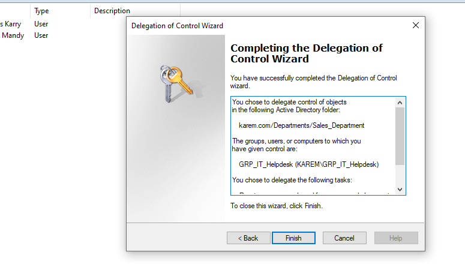

## 3. IT Support & Domain Controller Command Reference

| Command | What It Does | Key Detail for Domain Controllers | 
| :--- | :--- | :--- | 
| `ipconfig` | Displays basic TCP/IP configuration: IP address, subnet mask, and default gateway. | Quick check of the DC's current IP address. | 
| `ipconfig /all` | Displays full TCP/IP configuration, including MAC address, DHCP status, DNS servers, and WINS servers. | Essential for verifying the DC points to the correct DNS server (`127.0.0.1`) for Active Directory. | 
| `ipconfig /release` | Releases the current DHCP lease and sets the adapter IP to `0.0.0.0`. | Rarely used on a DC with a static IP. If the DC uses DHCP, this makes it unreachable. | 
| `ipconfig /renew` | Contacts DHCP to request a new IP address lease. | Typically used only if the DC is DHCP-configured. | 
| `ping` | Sends ICMP Echo Requests to test IP connectivity and name resolution. | Used to verify reachability between clients, partner DCs, and DNS servers. | 
| `net user <username> /domain` | Displays details about a domain user account by querying a domain controller. | The `/domain` switch queries the DC for account status, last logon, and password expiry. | 
| `systeminfo` | Displays detailed configuration information about OS version, build, hardware properties, and installed updates. | Critical for documenting DC patch levels, system architecture, and compliance audits. | 

*Commands executed during lab verification: `ipconfig /all` (Phase 4), `gpupdate /force` (Phase 5), `ping karem.com` (Phase 8), `whoami` (Phase 9).*

## 4. Troubleshooting Log: Real-World Issue Resolved

> **Incident:** Windows 10 client (`DESKTOP-P80NB90`) initially failed to locate the domain controller when attempting to join `karem.com` (`Ping request could not find host karem.com` / `Destination host unreachable`).
>
> **Root Cause:** Multi-adapter virtual network mismatch (`Ethernet0` LAN Segment vs. `Ethernet1` NAT) combined with a DHCP lease change on the Domain Controller (`192.168.169.139` → `192.168.169.137`).
>
> **Resolution:** Re-pointed the client's reachable NAT adapter (`Ethernet1`) Preferred DNS to `192.168.169.137`, flushed the DNS cache, and completed the domain join.

### Diagnosis & Resolution Steps

1. **Verified DC Addressing:** Executed `ipconfig` on `ALX-DC-01` and confirmed its active NAT interface IP had shifted to `192.168.169.137`.
2. **Isolated Client Virtual NIC:** Identified that `Ethernet0` on Windows 10 was attached to an isolated LAN segment (`169.254.x.x` APIPA), whereas `Ethernet1` (`192.168.169.133`) shared the NAT subnet with the DC.
3. **Updated DNS & Flushed Resolver:** Configured `Ethernet1` Preferred DNS to `192.168.169.137`, ran `ipconfig /flushdns`, and verified resolution via `ping karem.com` (`0% loss`).
4. **Preventive Hardening:** Converted `ALX-DC-01` from DHCP to a static IP configuration (`192.168.169.137`) pointing to `127.0.0.1` for DNS to prevent future lease-induced outages.

## 5. Operational Observations

| Observation | Lab Evidence | Production Recommendation | 
| :--- | :--- | :--- | 
| **DC Initial DHCP Lease** | Phase 4 (`DHCP Enabled: Yes`) | Enforce static IP addressing on all Domain Controllers prior to promotion. | 
| **Unpatched Baseline OS** | Phase 1 (`Last installed updates: Never`) | Configure WSUS or scheduled Windows Update maintenance windows. | 
| **ACL Break-Glass Access** | Phase 6 (`IT_Files` explicit ACEs) | Document ownership takeover procedures for Tier 3 emergency recovery. | 
| **Legacy Name Resolution** | Phase 4 (`NetBIOS over Tcpip: Enabled`) | Disable NetBIOS over TCP/IP and LLMNR via GPO where legacy apps are absent. | 