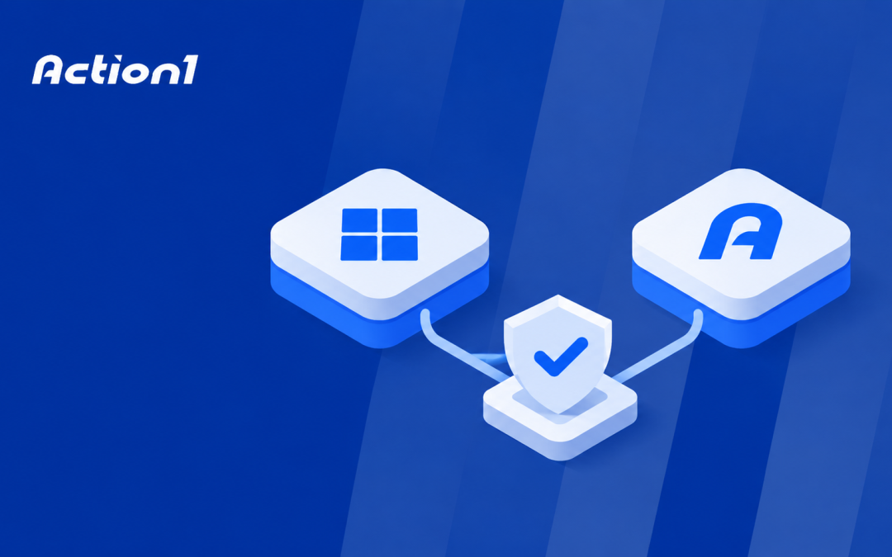
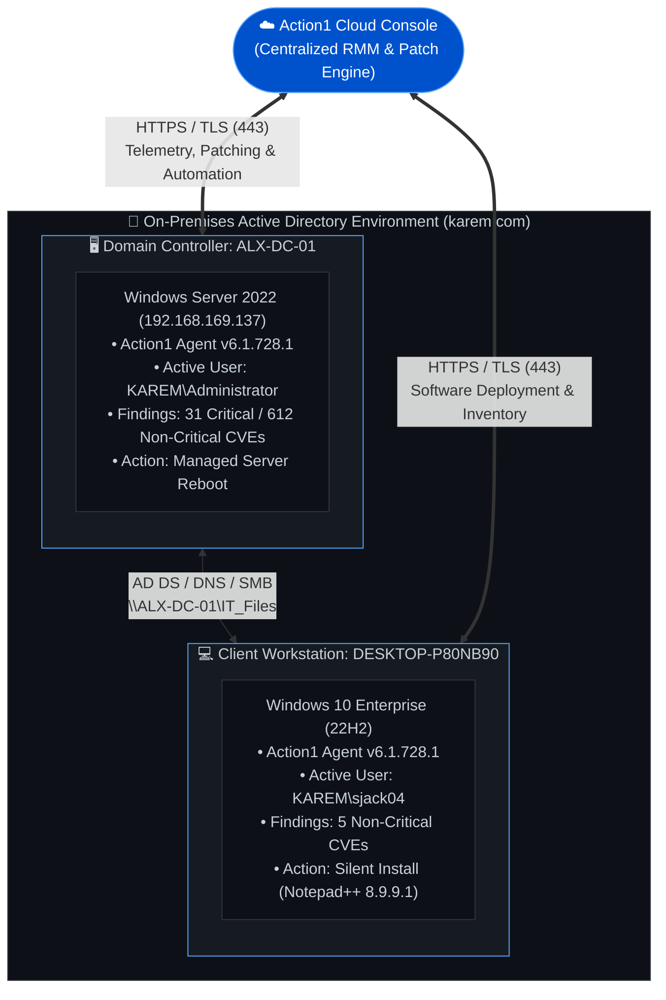

  <h1>☁️ RMM & Endpoint Management Lab (Action1)</h1>
  <strong>Cloud-Based Patch Management, Asset Inventory, Vulnerability Scanning & Remote Automation</strong>

  

    
    
    
  

  

---

## ✨ Overview

This module extends our core corporate domain infrastructure (**[`01-Windows-Helpdesk-Lab`](../01-Windows-Helpdesk-Lab)**) by integrating **Action1**, a cloud-native Remote Monitoring and Management (RMM) platform, across both the Domain Controller and domain-joined client workstations in the **`karem.com`** environment.

It demonstrates modern **Tier 1 / Tier 2 Endpoint Administration** workflows—covering agent deployment via internal SMB shares, centralized software inventory auditing, real-time CVE vulnerability detection, silent remote software deployment, and user-notified managed server reboots.

> 📄 **Full Technical Walkthrough & Verification Log:** Read the complete step-by-step documentation in **[`RMM-Lab.md`](RMM-Lab.md)**.

---

## 🏗️ RMM Integration Architecture

## 🖥️ Managed Endpoints

| Managed Endpoint | Role & OS | Active User Context | Agent Status | Key Operations Executed |
| :--- | :--- | :--- | :--- | :--- |
| **`ALX-DC-01.karem.com`** | Domain Controller (Windows Server 2022) | `KAREM\Administrator` | Connected | Software Audit, CVE Scan (31 Critical), Managed Reboot |
| **`DESKTOP-P80NB90.karem.com`** | Client Workstation (Windows 10 22H2) | `KAREM\sjack04` | Connected | Vulnerability Audit, Silent Deployment (Notepad++) |

---

## 📂 Folder Contents

- **[`RMM-Lab.md`](RMM-Lab.md)** — Detailed 5-phase technical documentation, operational objectives, CVE findings analysis, and verification screenshots.
- **[`RMM-Screenshots/`](RMM-Screenshots/)** — 5 sequential verification screenshots (01 through 05).

---

### ☁️ Microsoft 365 & Hybrid Cloud Integration
Directory synchronization via Entra Connect, Microsoft 365 licensing, Exchange Online, Teams governance, and Intune MDM enrollment for this domain are documented in [`03-Microsoft-365-Administration`](../03-Microsoft-365-Administration).

### 🎫 Next Step: Live Testing & Support Tickets
Critical vulnerabilities and operational hurdles across the AD and RMM environments—including Critical CVE patch remediation—are documented as structured support tickets in [`04-IT-Support-Tickets`](../04-IT-Support-Tickets).
