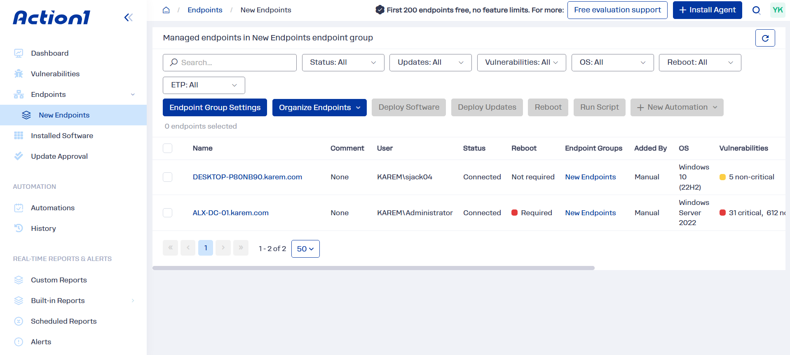
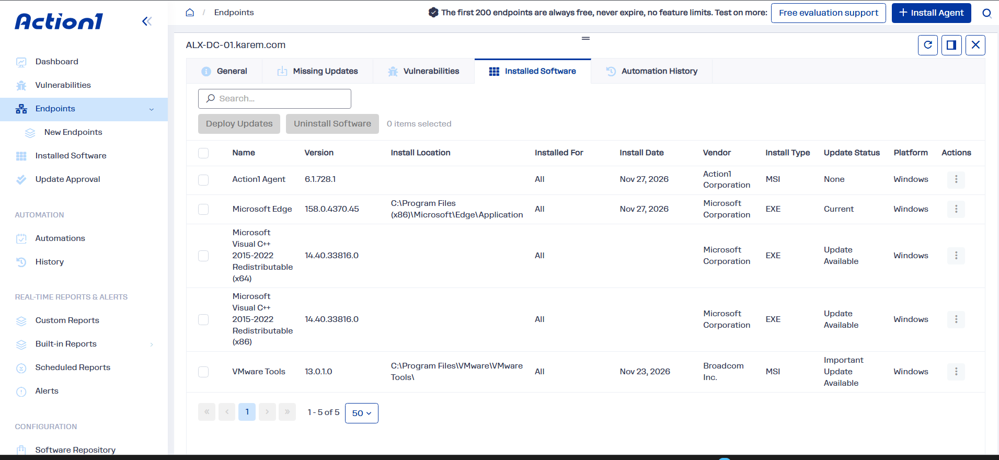
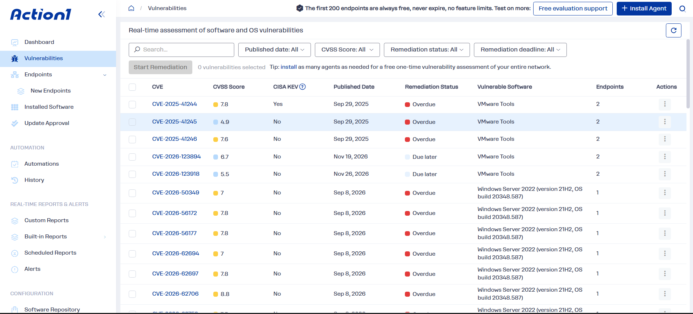
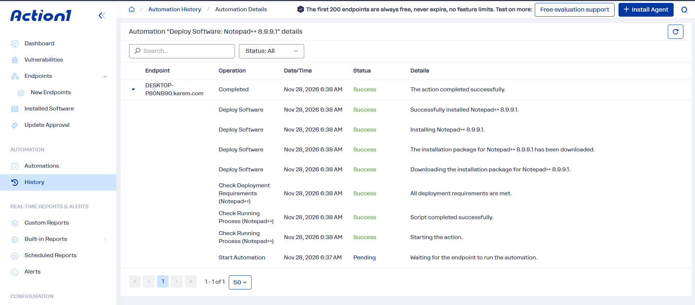
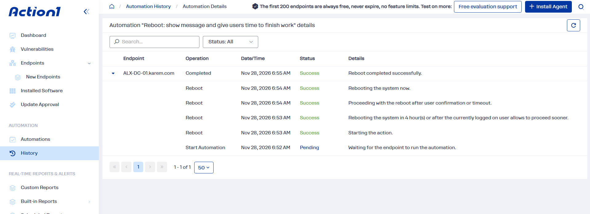

# ☁️ RMM & Endpoint Management — Technical Walkthrough (`Action1`)

**Environment:** `karem.com` Enterprise Lab (`ALX-DC-01` & `DESKTOP-P80NB90`)  
**Prerequisite Infrastructure:** [`01-Windows-Helpdesk-Lab`](../01-Windows-Helpdesk-Lab)  
**RMM Platform:** Action1 Cloud (Agent `v6.1.728.1`)  

---

## 📋 Executive Summary

This document provides the complete technical implementation log for onboarding and managing the **`karem.com`** Windows domain infrastructure using **Action1 RMM**. By deploying lightweight background agents (`LocalSystem` service) onto both the Windows Server 2022 Domain Controller and the Windows 10 Enterprise workstation, centralized visibility, automated vulnerability assessment, silent software provisioning, and graceful reboot orchestration were achieved across the network.

---

## 🛠️ Phase-by-Phase Implementation & Verification

### Phase 1: Agent Deployment & Domain Endpoint Onboarding

#### 🎯 Objective
Enroll both domain infrastructure nodes (`ALX-DC-01` and `DESKTOP-P80NB90`) into the Action1 cloud management console and verify Active Directory domain identity and logged-on user telemetry.

#### ⚙️ Execution Steps
1. Provisioned a cloud tenant on **Action1** and downloaded the organization-specific Windows Installer package (`action1_agent.msi`).
2. Leveraged the internal corporate SMB file share (`\\ALX-DC-01\IT_Files`) configured in **[`01-Windows-Helpdesk-Lab`](../01-Windows-Helpdesk-Lab)** to distribute the installer across the local virtual network without external bandwidth overhead.
3. Executed the `.msi` installation on both **`ALX-DC-01`** (Domain Controller) and **`DESKTOP-P80NB90`** (Client Workstation).
4. Verified in the **Endpoints (`New Endpoints`)** dashboard that both endpoints established persistent outbound HTTPS (`TCP 443`) connections and accurately reported their FQDN (`ALX-DC-01.karem.com`, `DESKTOP-P80NB90.karem.com`), OS builds, and active domain user sessions (`KAREM\Administrator` and `KAREM\sjack04`).

#### 📸 Verification

---

### Phase 2: Centralized Software & Asset Inventory Auditing

#### 🎯 Objective
Perform agent-based software inventory discovery to audit installed applications, version numbers, installation directories, vendors, and patch compliance statuses without interrupting local users.

#### ⚙️ Execution Steps
1. Navigated to **Endpoints** and selected **`ALX-DC-01.karem.com`** -> **Installed Software**.
2. Audited the discovered software baseline, confirming:
   * **Action1 Agent (`6.1.728.1`)** — Active RMM telemetry agent.
   * **Microsoft Edge (`158.0.4370.45`)** — Status: `Current`.
   * **Microsoft Visual C++ 2015–2022 Redistributable (x64 & x86, `14.40.33816.0`)** — Status: `Update Available`.
   * **VMware Tools (`13.0.1.0`)** — Status: `Important Update Available`.

#### 📸 Verification

---

### Phase 3: Real-Time Vulnerability Assessment (CVE Scanning)

#### 🎯 Objective
Conduct automated real-time vulnerability scanning across managed endpoints to identify unpatched operating system and third-party software vulnerabilities prioritized by **CVSS v3** severity and **CISA KEV** (Known Exploited Vulnerabilities) catalogs.

#### ⚙️ Execution Steps
1. Opened the **Vulnerabilities** module in Action1 to review real-time scan telemetry across the `karem.com` endpoints.
2. Analyzed the findings:
   * **`ALX-DC-01.karem.com`:** Flagged **31 Critical** and **612 Non-Critical** vulnerabilities, including CISA KEV-listed `VMware Tools` vulnerabilities (`CVE-2025-41244` with CVSS `7.8`, `CVE-2025-41246` with CVSS `7.6`) and overdue `Windows Server 2022 (21H2, OS Build 20348.587)` cumulative security updates (`CVE-2026-62706` with CVSS `8.8`).
   * **`DESKTOP-P80NB90.karem.com`:** Flagged **5 Non-Critical** third-party software vulnerabilities.
3. Logged these critical findings for structured patch remediation and post-patch verification inside **[`04-IT-Support-Tickets`](../04-IT-Support-Tickets)**.

#### 📸 Verification

---

### Phase 4: Silent Remote Software Deployment

#### 🎯 Objective
Deploy standardized productivity software silently to domain workstations from the cloud repository without requiring end-user interaction or local administrative privileges.

#### ⚙️ Execution Steps
1. Selected **`DESKTOP-P80NB90.karem.com`** from the **Endpoints** console and initiated the **Deploy Software** workflow.
2. Selected **`Notepad++ 8.9.9.1`** from the Action1 built-in software repository and executed an immediate deployment automation.
3. Tracked real-time execution states inside **Automation History** (`Pending` -> `Running` -> `Success`), confirming silent background installation (`Process (Notepad++) - Success`) while user `KAREM\sjack04` remained logged in.

#### 📸 Verification

---

### Phase 5: Managed Server Reboot Automation

#### 🎯 Objective
Resolve pending system restart flags (`Reboot: Required`) on critical server infrastructure safely by issuing a managed reboot policy with an advance user notification prompt.

#### ⚙️ Execution Steps
1. Identified that **`ALX-DC-01.karem.com`** reported a pending `Reboot: Required` state during endpoint health checks.
2. Triggered the **Reboot** automation on `ALX-DC-01.karem.com` using the policy *"Reboot: show message and give users time to finish work"*.
3. Verified the full execution audit trail in **Automation History**:
   * User notification prompt delivered (`06:53 AM`).
   * Timeout / user confirmation processed (`06:54 AM`).
   * Graceful system restart executed and agent reconnected (`06:55 AM` — `Reboot completed successfully`).

#### 📸 Verification

---

## 🔗 Integration with Other Portfolio Modules

| Module | Relationship to RMM Lab |
| :--- | :--- |
| **[`01-Windows-Helpdesk-Lab`](../01-Windows-Helpdesk-Lab)** | Provides the underlying Active Directory domain (`karem.com`), DNS resolution, and SMB share (`\\ALX-DC-01\IT_Files`) used for agent rollout. |
| **[`04-IT-Support-Tickets`](../04-IT-Support-Tickets)** | Tracks formal Tier 1 / Tier 2 incident resolution for the critical CVEs, NTFS/Share permission lockouts, and DNS configuration issues encountered in this environment. |
