# Hybrid Microsoft 365 Implementation Walkthrough

> **Module:** `03-Microsoft-365-Administration` · **Repository:** `Enterprise-IT-Infrastructure`
> **On-Premises Domain:** `karem.com` (`ALX-DC-01`, Windows Server 2022) · **Cloud Tenant:** `KaremIT.onmicrosoft.com`

[⬅️ Back to Module Overview](./README.md)

---

## Table of Contents

1. [Microsoft 365 Tenant & License Management](#section-1-microsoft-365-tenant--license-management-01-microsoft-365)
2. [Hybrid Identity & Security Governance](#section-2-hybrid-identity--security-governance-02-entra-id)
3. [Exchange Online & Mail Flow Administration](#section-3-exchange-online--mail-flow-administration-03-exchange)
4. [Microsoft Teams Workspace & Policy Governance](#section-4-microsoft-teams-workspace--policy-governance-04-teams)
5. [Microsoft Intune MDM & Endpoint Compliance](#section-5-microsoft-intune-mdm--endpoint-compliance-05-intune)
6. [Final Verification Matrix](#final-verification-matrix)

---

## Implementation Flow

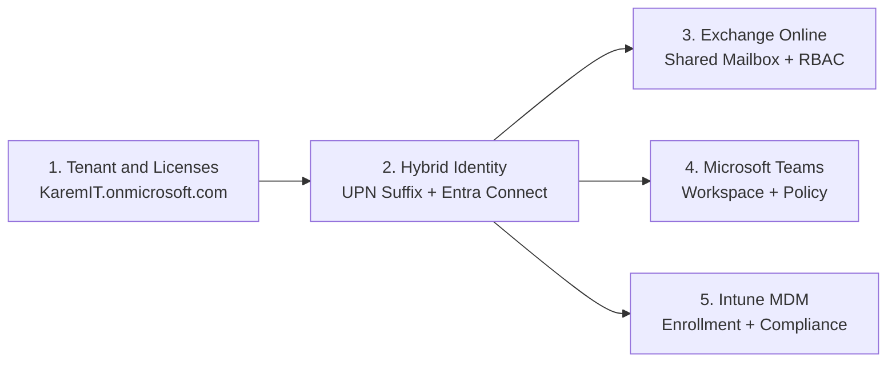

---

## Section 1: Microsoft 365 Tenant & License Management (`01-Microsoft-365`)

**Objective:** Establish the cloud tenant, validate subscription capacity, and assign licenses to identities synchronized from on-premises Active Directory.

### 1.1 Tenant Provisioning & Subscription Validation

**Configuration steps**

1. Provisioned the Microsoft 365 tenant `KaremIT.onmicrosoft.com`.
2. Procured **25 × Microsoft 365 Business Premium** licenses.
3. Signed in to the Microsoft 365 Admin Center as Global Administrator **Youssef Karem** (`YoussefKarem@KaremIT.onmicrosoft.com`).
4. Reviewed **Billing → Your products** to confirm subscription status and available license count.

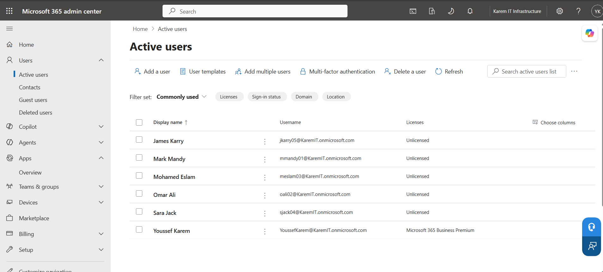

**Verification outcome**

| Check | Expected | Result |
|---|---|---|
| Tenant domain | `KaremIT.onmicrosoft.com` | ✅ Active |
| Subscription | Microsoft 365 Business Premium | ✅ Active |
| Total licenses | 25 | ✅ Confirmed |

### 1.2 License Assignment to Synchronized Users

**Configuration steps**

1. Opened **Users → Active users** in the Admin Center and confirmed the on-premises accounts replicated from `karem.com`.
2. Selected the synchronized users: Sara Jack, Mohamed Eslam, Omar Ali, James Karry, and Mark Mandy.
3. Used **Manage product licenses** to assign **Microsoft 365 Business Premium** in bulk.
4. Confirmed that each user's Licenses and apps tab shows the product as assigned.

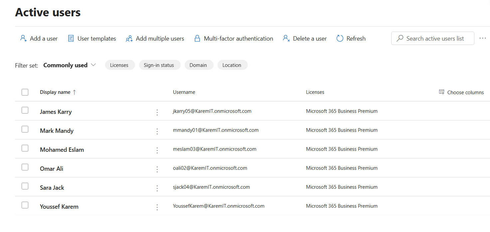

**Licensed identities**

| User | UPN | License |
|---|---|---|
| Sara Jack | `sjack04@KaremIT.onmicrosoft.com` | Microsoft 365 Business Premium |
| Mohamed Eslam | `meslam03@KaremIT.onmicrosoft.com` | Microsoft 365 Business Premium |
| Omar Ali | `oali02@KaremIT.onmicrosoft.com` | Microsoft 365 Business Premium |
| James Karry | `jkarry05@KaremIT.onmicrosoft.com` | Microsoft 365 Business Premium |
| Mark Mandy | `mmandy01@KaremIT.onmicrosoft.com` | Microsoft 365 Business Premium |

**Verification outcome:** All five synchronized users show **Microsoft 365 Business Premium** as licensed, which unlocks Exchange Online, Teams, and Intune services for the following sections.

---

## Section 2: Hybrid Identity & Security Governance (`02-Entra-ID`)

**Objective:** Bridge on-premises Active Directory and Microsoft Entra ID so that users authenticate with a consistent cloud-routable identity.

```
 ALX-DC-01 (karem.com)                              Microsoft Entra ID
 ┌──────────────────────────┐   Entra Connect Sync   ┌─────────────────────────────┐
 │ Users  (sjack04, ...)    │ ─────────────────────► │ Hybrid user objects         │
 │ Group  GRP_IT_Helpdesk   │                        │ Group  GRP_IT_Helpdesk      │
 │ UPN: @KaremIT.onmicro... │                        │ Security Defaults: Enabled  │
 └──────────────────────────┘                        └─────────────────────────────┘
```

### 2.1 Alternative UPN Suffix & Microsoft Entra Connect Sync Configuration

**Why this matters:** The internal domain `karem.com` is non-routable and cannot be verified as a public domain in the tenant. Adding `KaremIT.onmicrosoft.com` as an alternative UPN suffix lets on-premises accounts sign in to cloud services with a UPN that matches the tenant.

**Configuration steps**

1. On `ALX-DC-01`, opened **Active Directory Domains and Trusts → Properties** and added `KaremIT.onmicrosoft.com` as an **alternative UPN suffix**.
2. In **Active Directory Users and Computers**, updated each user's **User logon name** to use the new suffix (for example, `sjack04@KaremIT.onmicrosoft.com`).
3. Installed and configured **Microsoft Entra Connect Sync**, authenticating to the tenant with the Global Administrator account.
4. Ran the initial synchronization cycle to export the directory objects.

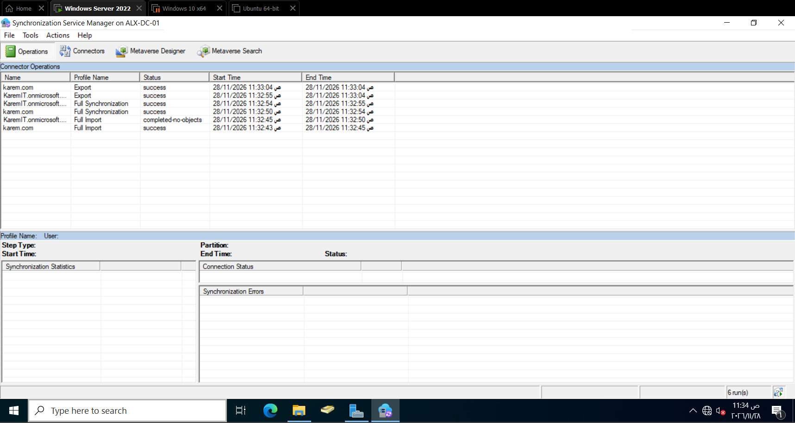

<details>
<summary>Reference: PowerShell equivalent</summary>

```powershell
# Add the alternative UPN suffix to the forest
Get-ADForest | Set-ADForest -UPNSuffixes @{Add="KaremIT.onmicrosoft.com"}

# Update a user's UPN
Set-ADUser -Identity "sjack04" -UserPrincipalName "sjack04@KaremIT.onmicrosoft.com"

# Trigger a delta synchronization cycle (on the Entra Connect server)
Start-ADSyncSyncCycle -PolicyType Delta
```

</details>

**Verification outcome**

| Check | Result |
|---|---|
| Alternative UPN suffix present in AD | ✅ `KaremIT.onmicrosoft.com` |
| User logon names updated | ✅ Aligned with tenant suffix |
| Entra Connect Sync configured and running | ✅ Successful |

### 2.2 Hybrid Sync Status Verification

**Configuration steps**

1. Opened the **Microsoft Entra Admin Center → Identity → Users → All users**.
2. Added the **On-premises sync enabled** column and reviewed the synchronized accounts.

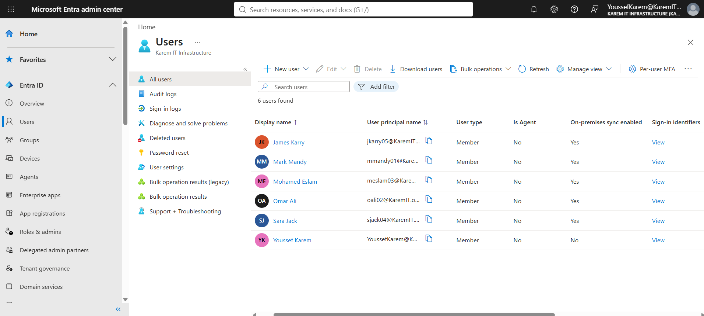

**Verification outcome:** Synchronized user objects display **`On-premises sync enabled: Yes`**, confirming that Active Directory is the source of authority and that the objects were created by Entra Connect Sync rather than as cloud-only accounts.

### 2.3 Security Group Replication & Tenant Security Defaults

**Configuration steps**

1. In **Entra Admin Center → Groups → All groups**, verified that the on-premises security group **`GRP_IT_Helpdesk`** was replicated.
2. Confirmed the group source is **Windows Server AD** and membership reflects on-premises assignments.
3. Opened **Identity → Overview → Properties → Manage security defaults** and confirmed **Security Defaults** are enabled to require MFA registration and block legacy authentication.

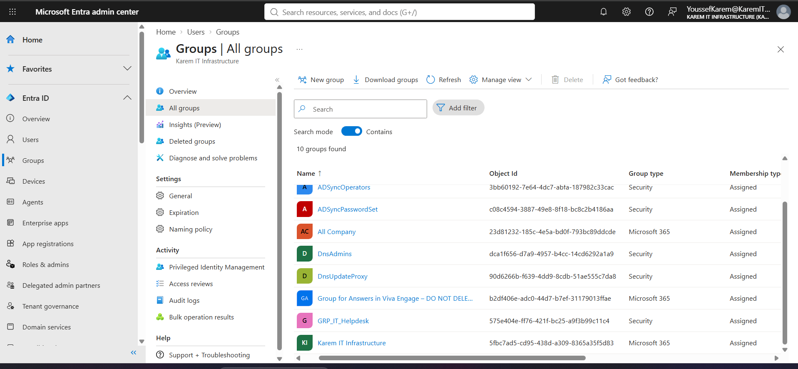

**Verification outcome**

| Check | Result |
|---|---|
| `GRP_IT_Helpdesk` replicated to Entra ID | ✅ Present (source: on-premises AD) |
| Security Defaults (MFA baseline) | ✅ Enabled |

---

## Section 3: Exchange Online & Mail Flow Administration (`03-Exchange`)

**Objective:** Provide the IT Helpdesk with a shared support mailbox governed by role-based delegation.

```
        it-support@KaremIT.onmicrosoft.com  (Shared Mailbox)
                           │
         ┌─────────────────┴─────────────────┐
     Full Access                          Send As
     (read / manage)               (send as the mailbox)
         └─────────────────┬─────────────────┘
                     Sara Jack
                (Helpdesk Specialist)
```

### 3.1 Shared Mailbox Provisioning

**Configuration steps**

1. Opened the **Exchange Admin Center → Recipients → Mailboxes → Add a shared mailbox**.
2. Created the mailbox with display name **IT Support** and address `it-support@KaremIT.onmicrosoft.com`.
3. Confirmed the mailbox appears in the Shared mailboxes list. Shared mailboxes do not require a user license.

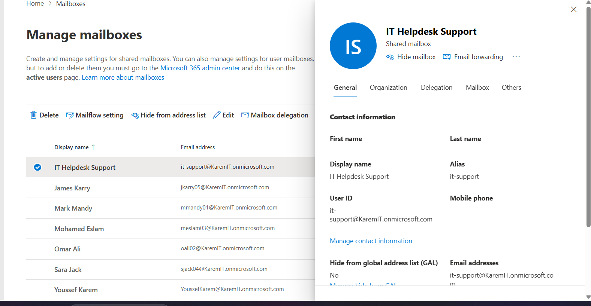

**Verification outcome:** `it-support@KaremIT.onmicrosoft.com` is listed with recipient type **Shared mailbox**.

### 3.2 RBAC Delegation: Full Access & Send As

**Configuration steps**

1. Selected the shared mailbox and opened **Delegation**.
2. Granted **Read and manage (Full Access)** to Helpdesk Specialist **Sara Jack** (`sjack04@KaremIT.onmicrosoft.com`).
3. Granted **Send as** to the same user so replies originate from the shared address rather than a personal mailbox.

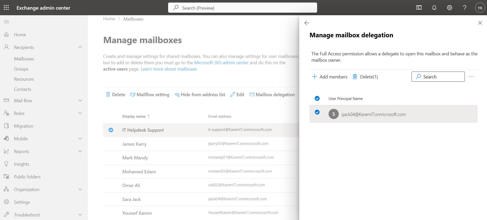

<details>
<summary>Reference: Exchange Online PowerShell equivalent</summary>

```powershell
Connect-ExchangeOnline -UserPrincipalName YoussefKarem@KaremIT.onmicrosoft.com

New-Mailbox -Shared -Name "IT Support" -PrimarySmtpAddress "it-support@KaremIT.onmicrosoft.com"

Add-MailboxPermission -Identity "it-support@KaremIT.onmicrosoft.com" `
    -User "sjack04@KaremIT.onmicrosoft.com" -AccessRights FullAccess -AutoMapping $true

Add-RecipientPermission -Identity "it-support@KaremIT.onmicrosoft.com" `
    -Trustee "sjack04@KaremIT.onmicrosoft.com" -AccessRights SendAs -Confirm:$false
```

</details>

**Verification outcome**

| Permission | Delegate | Result |
|---|---|---|
| Full Access | Sara Jack | ✅ Granted |
| Send As | Sara Jack | ✅ Granted |

### 3.3 Mail Flow Validation via Outlook on the Web

**Configuration steps**

1. Signed in to Outlook on the Web (OWA) as Sara Jack.
2. Confirmed the shared mailbox **IT Support** was mapped into the folder pane through delegation.
3. Composed a test message **`Ticket #101: Hybrid Exchange Verification`**, selecting `it-support@KaremIT.onmicrosoft.com` in the **From** field.
4. Sent the message and verified the result in the mailbox.

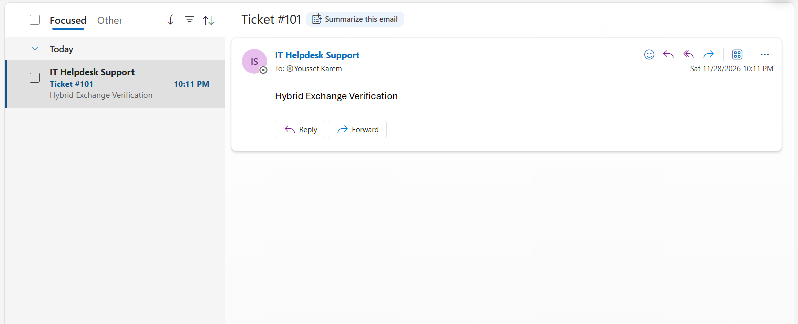

**Verification outcome:** The mailbox is accessible to the delegate in OWA, and the **Send As** message `Ticket #101: Hybrid Exchange Verification` was delivered, confirming end-to-end mail flow and correct RBAC delegation.

---

## Section 4: Microsoft Teams Workspace & Policy Governance (`04-Teams`)

**Objective:** Provision a departmental workspace for the IT Helpdesk and apply a custom policy through group-level assignment.

### 4.1 IT Helpdesk Operations Team Provisioning

**Configuration steps**

1. Opened the **Teams Admin Center → Teams → Manage teams → Add**.
2. Created the team **`IT Helpdesk Operations`**.
3. Onboarded IT personnel as members, assigning roles (Owner / Member) according to least-privilege principles.

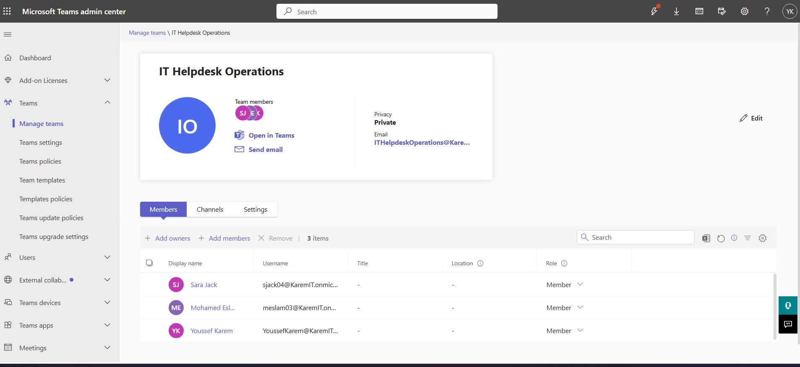

**Verification outcome:** `IT Helpdesk Operations` is listed in Manage teams with its members and roles populated.

### 4.2 Custom Governance Policy: `IT-Helpdesk-Policy`

**Configuration steps**

1. Navigated to **Teams Admin Center → Teams policies → Add**.
2. Created the custom policy **`IT-Helpdesk-Policy`** and configured the departmental settings required for Helpdesk operations.
3. Saved the policy and confirmed it appears under the **Custom policies** tab.

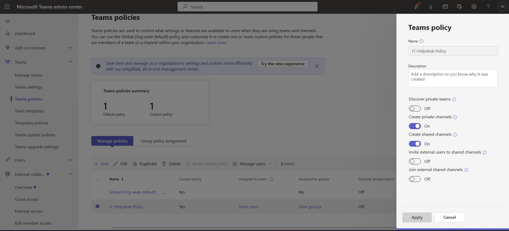

**Verification outcome:** `IT-Helpdesk-Policy` exists as a custom policy, separate from the Global (Org-wide default) policy.

### 4.3 Group Policy Assignment (Rank 1)

**Configuration steps**

1. Opened the **Teams policies → Group policy assignment** tab.
2. Selected the target group **IT Helpdesk Operations**.
3. Assigned **`IT-Helpdesk-Policy`** with assignment **Rank 1**, so the policy takes precedence over lower-ranked assignments when a user belongs to multiple groups.

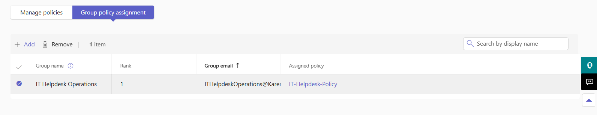

**Verification outcome**

| Check | Result |
|---|---|
| Target group | ✅ IT Helpdesk Operations |
| Assigned policy | ✅ `IT-Helpdesk-Policy` |
| Assignment rank | ✅ Rank 1 (highest precedence) |

---

## Section 5: Microsoft Intune MDM & Endpoint Compliance (`05-Intune`)

**Objective:** Bring a domain-joined Windows workstation under cloud MDM and enforce a security baseline through compliance policy.

```
 DESKTOP-P80NB90 ──► Entra ID auto-enrollment ──► Intune MDM ──► Compliance Policy ──► Compliant
 (karem.com joined)   (sjack04@KaremIT...)        (managed)      (Corporate-Windows10-    status
                                                                   Compliance)
```

### 5.1 Windows 10 Device Enrollment

**Endpoint profile**

| Attribute | Value |
|---|---|
| Device name | `DESKTOP-P80NB90` |
| Operating system | Windows 10 Pro, Build `10.0.19045.6466` |
| Domain membership | `karem.com` (domain-joined) |
| RMM | Action1 |
| MDM | Microsoft Intune |
| Enrolled user | `sjack04@KaremIT.onmicrosoft.com` |

**Configuration steps**

1. Confirmed the workstation was joined to `karem.com` and that the primary user, Sara Jack, was licensed with Microsoft 365 Business Premium (which includes Intune).
2. Completed MDM enrollment with Sara Jack's work account `sjack04@KaremIT.onmicrosoft.com`.
3. Opened the **Intune Admin Center → Devices → Windows** and located the device.
4. Reviewed the device's management and compliance state.

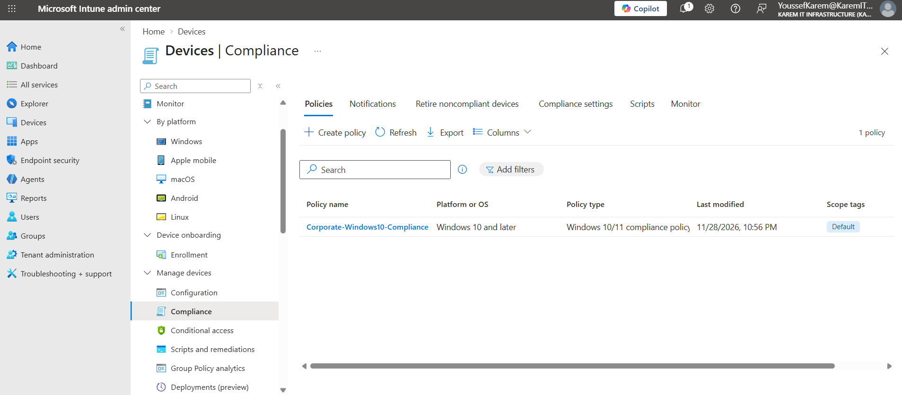

**Verification outcome:** `DESKTOP-P80NB90` is listed in Intune under `sjack04@KaremIT.onmicrosoft.com` with the status **Compliant**.

### 5.2 Compliance Policy: `Corporate-Windows10-Compliance`

**Configuration steps**

1. Navigated to **Intune Admin Center → Devices → Compliance → Create policy** and selected platform **Windows 10 and later**.
2. Named the policy **`Corporate-Windows10-Compliance`**.
3. Configured the security baseline requirements:
   - **Firewall:** required.
   - **Antivirus:** required.
   - **Microsoft Defender (anti-malware):** required.
4. Assigned the policy to the target users/devices and saved it.

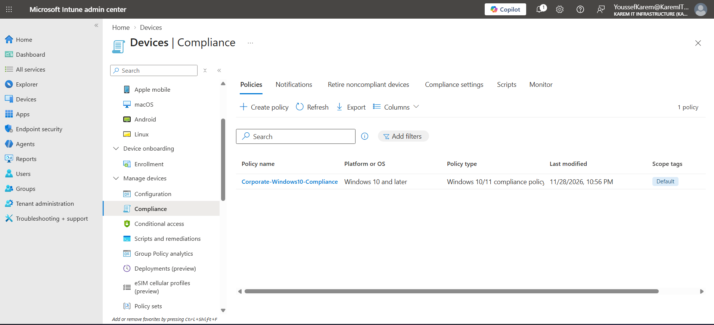

**Verification outcome**

| Baseline Control | Enforcement | Result |
|---|---|---|
| Firewall | Required | ✅ Configured |
| Antivirus | Required | ✅ Configured |
| Microsoft Defender | Required | ✅ Configured |
| Assigned device `DESKTOP-P80NB90` | Evaluated against policy | ✅ Compliant |

---

## Final Verification Matrix

| # | Pillar | Deliverable | Evidence | Status |
|---|---|---|---|---|
| 1 | Microsoft 365 | Tenant with 25 Business Premium licenses | `01-Tenant-Subscriptions.png` | ✅ |
| 1 | Microsoft 365 | Licenses assigned to synced users | `02-Synced-Users-Licensing.png` | ✅ |
| 2 | Entra ID | UPN suffix and Entra Connect Sync | `01-AD-UPN-And-Entra-Connect.png` | ✅ |
| 2 | Entra ID | `On-premises sync enabled: Yes` | `02-EntraID-Hybrid-Sync-Status.png` | ✅ |
| 2 | Entra ID | `GRP_IT_Helpdesk` and Security Defaults | `03-EntraID-Groups-And-Security.png` | ✅ |
| 3 | Exchange | Shared mailbox `it-support@` | `01-Exchange-Shared-Mailbox.png` | ✅ |
| 3 | Exchange | Full Access and Send As for Sara Jack | `02-Exchange-Delegation-Permissions.png` | ✅ |
| 3 | Exchange | Mail flow test (Ticket #101) | `03-OWA-Shared-Mailbox-Test.png` | ✅ |
| 4 | Teams | `IT Helpdesk Operations` team | `01-Teams-Admin-Helpdesk-Team.png` | ✅ |
| 4 | Teams | `IT-Helpdesk-Policy` | `02-Teams-Policies-Configuration.png` | ✅ |
| 4 | Teams | Group policy assignment, Rank 1 | `03-Teams-Group-Policy-Assignment.png` | ✅ |
| 5 | Intune | `DESKTOP-P80NB90` enrolled, Compliant | `01-Intune-Enrolled-Windows10.png` | ✅ |
| 5 | Intune | `Corporate-Windows10-Compliance` | `02-Intune-Compliance-Policy.png` | ✅ |

---

[⬅️ Back to Module Overview](./README.md)
