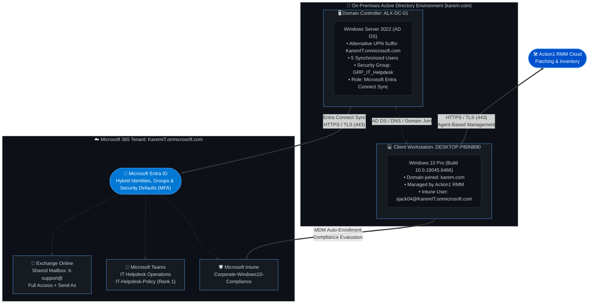

<div align="center">
  <h1>☁️ Hybrid Microsoft 365 & Cloud Administration</h1>
  <strong>Entra Connect Identity Sync, M365 Licensing, Exchange Online RBAC, Teams Policy Governance & Intune Endpoint Compliance</strong>

  <p>
    
    
    
    
  </p>
</div>
<div align="center">
  
</div>

---

## ✨ Overview

This module extends our core corporate domain infrastructure and the Action1 RMM deployment by integrating the on-premises **`karem.com`** Active Directory forest with a **Microsoft 365** tenant (**`KaremIT.onmicrosoft.com`**) through **Microsoft Entra Connect Sync**, and by bringing the domain-joined workstation under **Microsoft Intune** management.

It demonstrates modern **Tier 2 / Tier 3 Cloud Administration** workflows, covering custom UPN suffix configuration, hybrid identity synchronization, bulk license assignment, shared mailbox delegation, Teams policy governance, and MDM compliance enforcement across a **Microsoft 365 Business Premium (25 licenses)** subscription.

> 📄 **Full Technical Walkthrough & Verification Log:** Read the complete step-by-step documentation in **[`M365-Hybrid-Walkthrough.md`](M365-Hybrid-Walkthrough.md)**.

---

## 🏗️ Hybrid Infrastructure Architecture



## 🖥️ Environment & Identities

| Component | Role & Platform | Identity / Context | Status | Key Operations Executed |
| :--- | :--- | :--- | :--- | :--- |
| **`ALX-DC-01.karem.com`** | Domain Controller (Windows Server 2022) | `karem.com` (AD DS) | Synced | UPN Suffix Configuration, Entra Connect Sync, Group Replication |
| **`KaremIT.onmicrosoft.com`** | Microsoft 365 Tenant (Business Premium x 25) | `YoussefKarem@KaremIT.onmicrosoft.com` (Global Administrator) | Active | License Assignment, Exchange, Teams & Intune Administration |
| **`DESKTOP-P80NB90.karem.com`** | Client Workstation (Windows 10 Pro 19045.6466) | `sjack04@KaremIT.onmicrosoft.com` | Compliant | Intune Enrollment, Compliance Policy Evaluation |

---

## 🧩 Core Administrative Pillars & Capabilities

| # | Pillar | Scope | Key Capabilities Demonstrated |
| :---: | :--- | :--- | :--- |
| 1 | **`01-Microsoft-365`** | Tenant & Licensing | Tenant provisioning (`KaremIT.onmicrosoft.com`), subscription governance, automated license assignment (**Microsoft 365 Business Premium**) |
| 2 | **`02-Entra-ID`** | Hybrid Identity & Security | Custom UPN suffix configuration, hybrid identity sync via **Entra Connect Sync**, AD group replication (`GRP_IT_Helpdesk`), **Security Defaults (MFA)** |
| 3 | **`03-Exchange`** | Messaging & Mail Flow | Shared mailbox provisioning (`it-support@KaremIT.onmicrosoft.com`), RBAC delegation (**Full Access** & **Send As**), OWA mail flow validation |
| 4 | **`04-Teams`** | Workspace & Governance | Departmental workspace provisioning (**IT Helpdesk Operations**), RBAC membership management, custom policy assignment (**`IT-Helpdesk-Policy`**, Rank 1) |
| 5 | **`05-Intune`** | MDM & Compliance | MDM auto-enrollment (`DESKTOP-P80NB90`), security baseline enforcement via **`Corporate-Windows10-Compliance`** |

---

## 📂 Folder Contents

```
03-Microsoft-365-Administration/
├── README.md
├── M365-Hybrid-Walkthrough.md
└── M365-Screenshots/
    ├── lab-banner.png
    ├── 01-Microsoft-365/
    ├── 02-Entra-ID/
    ├── 03-Exchange/
    ├── 04-Teams/
    └── 05-Intune/
```

- **[`M365-Hybrid-Walkthrough.md`](M365-Hybrid-Walkthrough.md)**: Detailed 5-section technical documentation, configuration steps, verification outcomes, and embedded evidence screenshots.
- **[`M365-Screenshots/`](M365-Screenshots/)**: 13 sequential verification screenshots across 5 subfolders (`01-Microsoft-365` through `05-Intune`), plus the banner image.

---

## 🎫 Next Step: Live Testing & Support Tickets

Real-world operational scenarios across the hybrid environment, including **license assignment failures, sync errors, mailbox access issues, and device compliance remediation**, are documented as structured support tickets in **[`04-IT-Support-Tickets`](../04-IT-Support-Tickets)**.
